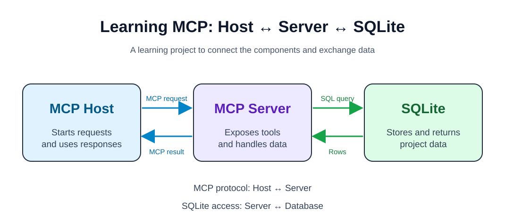

# MCP Learning

This public repository is a hands-on project for learning how to build and configure Model Context Protocol (MCP) components.

## Project goal

Build an MCP Host and an MCP Server, connect the server to a SQLite database, and make the components communicate end to end. The host will send MCP requests to the server and use its responses. The server will expose tools, query SQLite, and return results to the host.

The [editable Excalidraw diagram](docs/architecture.excalidraw) is the source for this architecture sketch.

## Status

The repository currently contains the project plan and architecture diagram. Implementation will be added as I learn.
