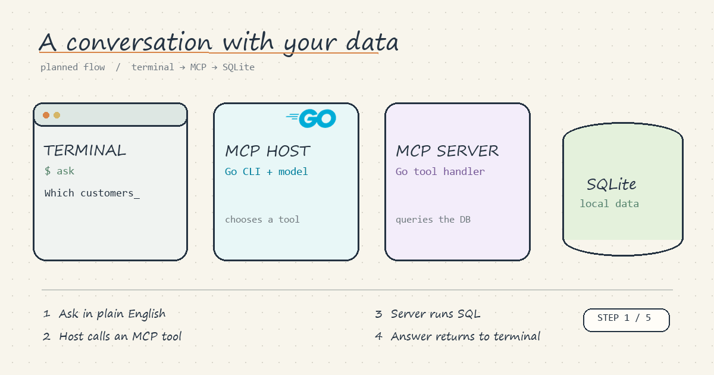

# MCP Learning

This public repository is a hands-on project for learning how to build and configure Model Context Protocol (MCP) components.

## The idea

Ask questions about a local SQLite database in plain English from a terminal. A Go CLI will act as the MCP Host. A model in the host will choose a tool exposed by a Go MCP Server. The server will run the database operation and send the result back through MCP, so the terminal can show a useful answer.

1. Type a question in the terminal.
2. The host selects and calls an MCP tool.
3. The Go server queries SQLite.
4. The result returns to the host and appears as an answer in the terminal.

This is the **planned flow**, not a working implementation yet. The [editable Excalidraw source](docs/architecture.excalidraw) and a [static poster](docs/architecture-poster.png) are also available. The [Go logo](https://go.dev/brand) is an official Go brand asset used to identify the programming language.

## Status

The repository currently contains the plan and architecture sketch. Implementation will be added as I learn.
